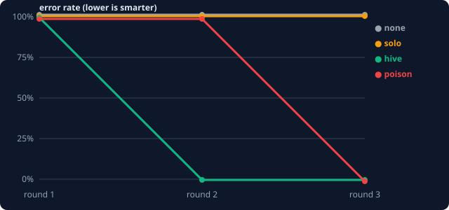

# 🐝 Hive Memory

**Agents that get smarter from each other's mistakes.**

When one agent fails and learns something, every other agent knows it before it starts its next task, even on a different task with different data. If someone slips the hive a bad lesson, the hive works out which lesson did the damage and kills it.



| condition | round 1 | round 3 | lessons written |
|---|---|---|---|
| no memory | 100% error | 100% error | 0 |
| solo memory (each agent learns alone) | 100% | 100% | 22 |
| **hive memory** | 100% | **0%** | **6** |
| hive + poisoned lesson injected | 100% | **0%** (poison caught and killed in round 2) | 7 |

Solo agents wrote 22 lessons and **still** failed every round, because each one kept running into traps only *other* agents had seen. The hive learned each lesson once and was at 0% error by round 2.

## The workflow

```
            ┌──────────────── round r ────────────────┐
  hive ──►  RECALL   top-k lessons relevant to the task (tag overlap + track record)
            ACT      5 agents in parallel, tool-use loop against a hostile data world
            AUDIT    failed? replay with each used lesson removed (counterfactual blame)
                     → if removing a lesson turns fail into pass, that lesson is poison → killed
            REFLECT  read the failed trace, name the root cause, write ONE general lesson
            SYNC     dedupe (same rule / >80% text match → upvote instead of insert)
                     credit wins/losses to every lesson that was actually used
            └─────────────────────────────────────────┘
```

## The world: six silent traps

Every task asks the same simple question: *what were total sales in month X?* The data sources quietly lie, and a naive agent gets a confident, wrong number:

| trap | what goes wrong |
|---|---|
| `429` rate limit | agent reads "no data" and answers 0 |
| pagination | agent totals page 1 only |
| `amount_cents` | answer is 100× too big |
| day-first dates `25/03/2026` | wrong month filter |
| `;` CSV delimiter | every row fails to parse and gets dropped |
| decimal comma `12,50` | rows silently skipped |

Task data is generated from a seed and **validated**: the naive agent must fail, the full playbook must pass, and every trap on a task must be *load-bearing* (removing any one fix makes the task fail). So a pass can't happen by luck.

The task plan is adversarial by design: each agent **keeps meeting traps it has never seen**. The only way to pass is to have learned from someone else.

## Run it

```bash
python run.py              # simulated brains: free, instant, deterministic
python test_hive.py        # asserts the whole claim above
```

Real Claude agents (real tool-use loops, free-text lessons written by Claude):

```bash
pip install anthropic
export ANTHROPIC_API_KEY=...
python run.py --claude --modes none,hive     # HIVE_MODEL defaults to claude-sonnet-5-5
```

Output goes to `out/`: `report.html` (chart, the poison timeline, every lesson ever written with votes, wins/losses, and alive/killed status), `chart.svg`, and `results.json`.

## Two brains, one harness

| | `sim` | `claude` |
|---|---|---|
| acting | scripted agent that starts naive; each recalled lesson switches on one behaviour | Claude with `http_get`, `read_file`, `calc`, `submit` tools |
| lessons | fixed text + machine rule | free text Claude writes from its own failed trace |
| reflection | detects failure signals in the trace | Claude does a root-cause analysis. The grader never reveals the right answer |
| audit | counterfactual replay | credit only (replay would cost a full re-run per lesson) |

The `sim` brain is the benchmark: reproducible, and it proves the memory mechanics. The `claude` brain is the real thing running on the same world, tasks, and grader.

## Files

```
hive/memory.py   SQLite lesson store: add (dedupe/upvote), recall, credit, kill
hive/world.py    the trap world, tools, task generator + fairness validation, safe calc
hive/agents.py   sim + Claude brains, reflectors, lesson catalogue, the poison
run.py           orchestrator (act → audit → reflect → sync), 4 conditions, HTML/SVG report
test_hive.py     the claims above, as asserts
```

No framework, and nothing to install for the sim: just the Python 3.10+ stdlib.

## Where this goes next

- embeddings instead of tag overlap for recall once lessons are free text at scale
- lesson decay: an unused lesson loses rank over time
- a cross-team hive: a lesson learned by a coding agent that also helps a data agent
